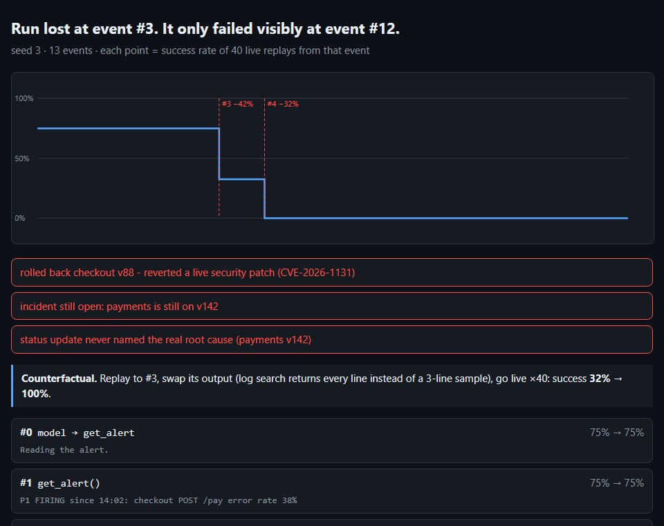

# agent-rewind

**Time-travel debugger for AI agents.** Rewind any run to any step, replay it exactly, change one thing, and see if the agent would have made it.

When an agent fails, the error you see is almost never where it went wrong. The run below crashed at step 12. It was lost at step 3.



## The idea

Every model reply and tool result goes onto a **tape**. From the tape you can:

| | |
|---|---|
| **Replay** | Feed the agent the same outputs and it takes the same path, step for step. Tools still execute during replay so their side effects (a rollback, a refund, a deleted row) are rebuilt for real, not mocked. If the agent ever does something the tape didn't record, you get a `Divergence` pointing at the exact step. |
| **Win-probability curve** | Freeze the first *k* events, let the agent run live from there *n* times, and record how often it still succeeds. Do that for every *k*. The curve shows when the run was still winnable and which step lost it. The biggest drop gets the blame. |
| **Bisect** | Live runs cost money on a real model. `bisect` binary-searches for the point of no return in `log2(steps)` probes: 120 runs instead of 390 in the demo (`-n 30`). |
| **Fork** | Replay up to step *k*, swap in a different output, and go live. "What if the log search hadn't dropped the error line?" gets a number back: **32% → 100%**. |

## Try it (no API key needed)

```bash
pip install -e .
rewind demo
```

```
1. Recorded a failing on-call run (seed 3). The failure shows at the end:
#3  search_logs(service=checkout)     13:40:02 checkout deploy v88 finished ...
#4  model → get_deploys               No clear error, but checkout v88 went out right before the alert
#7  rollback(service=checkout, version=v87)
...
FAILED: rolled back checkout v88 - reverted a live security patch; incident still open

2. Rewinding to every event, 40 live replays each...
 75% ███████████████  #3  search_logs(service=checkout)    −42% ← lost here
 32% ██████           #4  model → get_deploys              −32% ← lost here
  0%                  #5  get_deploys(service=checkout)
  ...
3. Fork: replay to #3, give the agent full logs instead of a sample: success 32% → 100%
```

The scenario is an on-call agent paged because checkout is throwing 500s. The real cause is a bad **payments** deploy. Two traps sit in its path:

- **The log tool is lossy.** It samples 3 lines out of 10, like most log search, so the lines that say `upstream payments timeout` can all be missing.
- **The wrong suspect looks guilty.** Checkout v88 shipped 22 minutes before the alert. Rolling it back is irreversible damage, because v88 carries a security patch.

The curve splits the blame in two. The tool hid the evidence (−42%), then the model committed to a guess without checking upstream (−32%). One fix is in the tool (return every error line) and one is in the prompt (check dependencies before rolling back). The fork proves the tool fix is enough on its own.

## Commands

```bash
rewind record --seed 7                        # record one run to tape.json
rewind curve tape.json -n 50                  # curve + blame + report.html
rewind bisect tape.json -n 20                 # point of no return, cheap
rewind fork tape.json --at 3 --out @logs.txt  # counterfactual on step 3
rewind demo --real                            # same thing against Claude (needs ANTHROPIC_API_KEY, pip install -e .[claude])
```

## Your own agent

The whole integration is two calls. Route model calls and tool calls through `tape.step` (see [`rewind/agent.py`](rewind/agent.py)):

```python
blocks = tape.step("llm", "llm", None, lambda: llm(system, messages, tools))
result = tape.step("tool", name, args, lambda: world.call(name, args))
```

Then pass your loop to the analysis: `curve(events, n, run=my_run)`, same for `bisect` and `fork`. `my_run(seed, prefix, edits, llm)` builds a fresh world, runs through a `Tape(prefix, edits)`, and returns `{"events": ..., "fails": [...]}`.

## How it's built

```
rewind/tape.py      record / replay / edit, divergence detection        (33 lines)
rewind/agent.py     agent loop, everything goes through the tape
rewind/analysis.py  curve, blame, bisect, fork
rewind/oncall.py    the sandbox: tools, grader, offline policy, Claude adapter
rewind/report.py    self-contained HTML report
```

No dependencies. `anthropic` is optional and only needed for `--real`.

## Honest limits

- Replay assumes a tool's side effects depend only on its arguments. Randomness and clock reads belong in the tool *output*, which the tape captures. Anything else needs a sandbox, which you should have anyway before letting an agent roll back production.
- `curve` costs `steps × n` runs, and each run is several model calls. On a real model `-n` defaults to 5 and the demo stops after 10 attempts to find a failure. Prefer `bisect` there. Replayed model steps are free because they come off the tape.
- The offline demo agent is a scripted, randomized policy so the demo runs free and deterministic in CI. `--real` swaps in Claude with the same tools and tape.

MIT
